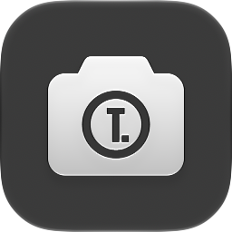

  <picture>
    <source media="(prefers-color-scheme: dark)" srcset="assets/topshelf-icon-dark.png">
    
  </picture>

<h1 align="center">Top Shelf</h1>

<strong>Fast photo culling for Mac — built for high-speed burst shooters.</strong>

Review a shoot straight off the card, pick the frames worth keeping, and copy only those to your library, verified byte for byte. Your originals are never touched.

> **About this repository:** this is where Top Shelf's releases, update feed, user guide, and privacy policy live. Top Shelf's source code is private and isn't published here.

[Download](#download-and-install) · [User guide](HELP.md) · [Privacy](PRIVACY.md) · [Releases](https://github.com/tmanish/top-shelf-releases/releases)

---

## Made for high frame-rate cameras

Modern stacked-sensor cameras shoot 20, 30, even 120 frames per second, and pre-capture modes save the moments *before* you pressed the shutter. A single afternoon of birds in flight, motorsport, or a first dance can mean thousands of frames that differ by a wingbeat.

Importing all of that into Lightroom just to throw most of it away is slow, fills your disk, and buries the good frames.

Top Shelf turns it around: **cull first, import only the keepers.**

- **Bursts, grouped for you.** Near-identical frames shot within moments of each other are grouped automatically, so 3,000 frames become a few hundred decisions.
- **Best of Each Burst.** Bursts one at a time, the strongest frame first. Top Shelf tells you why it's suggested — *eyes open*, *sharper subject*, *fewer clipped highlights* — and **P** picks it and moves to the next burst. Hold → to scrub through the burst like video.
- **One at a Time.** One frame, full size. **P** pick, **A** alternate, **X** not selected, and the next frame is already there. The filmstrip groups each burst, so you always see where you are.
- **Auto Suggest.** See the frames Top Shelf would keep across the whole shoot. Nothing is marked until you choose **Mark All as Pick** — and one ⌘Z undoes it.

Top Shelf works with the files your camera writes. Shooting with a Sony A1 or A9 III, Canon EOS R1 or R5 Mark II, Nikon Z8 or Z9, Fujifilm X-H2S, or an OM System body with Pro Capture? If macOS can open your RAW files, Top Shelf can cull them. RAW support comes from macOS, and Apple adds new cameras in system updates.

## What it does

**Review in place, instantly**
- Opens memory cards, cameras, external drives, and folders without importing anything.
- Groups the shoot into days and *moments*, and shows it as a grid, as burst strips, or as one card per group.
- True 100% inspection — ⌘-scroll or pinch to zoom, Space to toggle Fit/100%, two-finger swipe to the next frame.
- Side-by-side Compare with synchronized zoom.
- Plays video in place.

**Decide with confidence**
- On-device hints for subject sharpness, closed eyes, faces, and blown highlights. They only suggest — nothing is ever rejected automatically.
- Everything is undoable.

**Get the keepers out safely**
- **Verified copies.** Every copied file is checked against the original with SHA-256. Interrupted copies resume where they stopped, and nothing half-copied is ever reported as done. Progress shows on the Dock icon, with a notification when it's done.
- RAW + JPEG pairs and XMP sidecars stay together.
- **Ready for your editor.** Picks arrive rated ★★★★★ and Alternates ★★★, with shoot and moment names as keywords. Works with Lightroom Classic, Lightroom, Capture One, Photomator, and any app that reads XMP.
- **Lightroom Classic plug-in** (included) builds a collection set with Picks and Alternates for you.
- Drag photos out, copy them with ⌘C, or open them in another app — other apps always get a copy, never your original.
- A short **cull receipt** is saved beside every export.

**Built for real shooting days**
- Shooting to two cards at once? Open the second card and Top Shelf offers to carry your decisions over.
- Works with iCloud Drive folders, and says plainly which photos aren't downloaded yet.
- Designed for multi-thousand-frame days.

## Your photos stay yours

- **Never modifies your originals.** No renaming, moving, editing, tagging, or deleting — ever. Ratings and keywords go only on the copies.
- **No account, no cloud, no analytics, no tracking.** Photo analysis uses Apple's on-device frameworks.
- **The app itself can't reach the internet.** Update checks happen in a separate, sandboxed helper and send nothing about you or your photos.
- **Sandboxed.** Top Shelf can read only the cards and folders you choose, and write only where you tell it to.

Read the full [privacy policy](PRIVACY.md).

## Requirements

- macOS 14 Sonoma or later, on Apple silicon or Intel
- Optional: Lightroom Classic 6 or later for the collection plug-in

## Download and install

The first public release is being prepared. When it's out:

1. [Download Top Shelf](https://github.com/tmanish/top-shelf-releases/releases/latest/download/TopShelf.dmg) (always the latest version), or pick a file from [Releases](https://github.com/tmanish/top-shelf-releases/releases/latest).
2. Open it and drag **Top Shelf** to the Applications folder.
3. Eject the disk image, then open Top Shelf from Applications. On first launch you'll choose a working cache folder and a default export folder.

Every release published here is signed with the developer's Apple Developer ID and notarized by Apple.

What each download is:

- **`TopShelf.dmg`** is the app. This is the one to download.
- **`TopShelf-VERSION-BUILD.dmg`** is the same app, byte for byte, under its versioned name. The update feed points to this copy.
- **`.dmg.sha256`** is the file's checksum, if you want to confirm the download is intact.
- **`.md`** holds that version's release notes, which Top Shelf shows when it offers an update.
- **Source code (zip / tar.gz)** links are added automatically by GitHub to every release. They contain only this repository's documentation, app icon, and update feed, not Top Shelf's source code, which is private.

Releases labeled **Pre-release** are test builds used to check the update process before a public version ships. They look for updates on a separate test feed, so they won't receive regular updates. Please use the latest release without that label.

**Lightroom Classic plug-in (optional):** in Top Shelf choose **File ▸ Install Lightroom Plug-in…**, then restart Lightroom Classic.

## Updates

Top Shelf can look for new versions on its own. It asks you first, and you can change your answer any time in **Settings ▸ General ▸ Updates**. To check right now, choose **Top Shelf ▸ Check for Updates…**

Nothing is downloaded or installed until you say so. Every update is signed, and Top Shelf verifies the signature before installing anything. Your review sessions, decisions, and settings are kept.

## Help and feedback

- [User guide](HELP.md) — every workflow, keyboard shortcuts, and troubleshooting. It's built into the app too, and works offline: **Help ▸ Top Shelf Help** (⌘?) and **Help ▸ Keyboard Shortcuts**.
- Found a bug or have an idea? [Open an issue](https://github.com/tmanish/top-shelf-releases/issues/new) (or **Help ▸ Report an Issue…** in the app). Please include your macOS version, the Top Shelf version (**Top Shelf ▸ About Top Shelf**), your camera model, and the steps that led to the problem. Don't attach photos you wouldn't want to be public — issues are visible to everyone.

## Known limitations

- Reviewing directly from a connected camera is newer than card and folder review. If your camera misbehaves, insert its card instead.
- Photos stored only in iCloud must be downloaded before Top Shelf can preview or copy them.
- The collection plug-in requires Lightroom Classic. Lightroom (cloud) and Lightroom mobile receive ratings and keywords through the XMP sidecars instead.

## Acknowledgements

Top Shelf includes [Sparkle](https://sparkle-project.org) for updates, used under its MIT license; the full notice ships inside the app (**Help ▸ Acknowledgements**).
